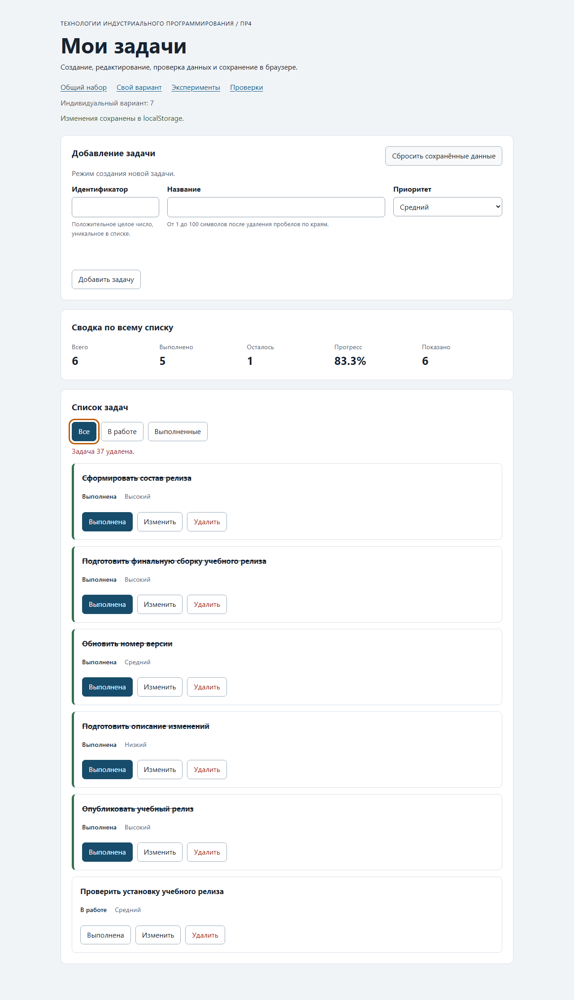

# Практическая работа № 4. Формы, валидация и локальное хранение данных

## Данные работы

| Поле | Значение |
|---|---|
| Имя | Шишов Даниил |
| Группа | ЭФБО-06-25 |
| Вариант из ПР2–ПР3 | 7 |
| Node.js | 24.21.0 |
| Браузер | Google Chrome 157.0.8103.39 |
| Операционная система | Windows 11 |

## Запуск

Рабочая папка: `practice-04` внутри личного репозитория.

```bash
npm test
npm start
```

Устанавливать зависимости через `npm install` не требуется.

```text
http://127.0.0.1:5504/
http://127.0.0.1:5504/index.html?dataset=variant
http://127.0.0.1:5504/examples/forms-storage.html
http://127.0.0.1:5504/checks.html
```

## Перенос результата ПР3

В заготовку ПР4 перенесены собственные реализации ПР2–ПР3. Сравнение `src/data.js` с файлом ПР3 показало совпадение по содержанию (отличается только отступ в элементах массива). Остальные модули переносились вручную и дополнялись по контрактам ПР4.

| Файл | Что перенесено или изменено |
|---|---|
| `data.js` | Перенесён без изменения общего контрольного набора (`[1, 4, 7, 10]`) и шести задач варианта 7 (`[11, 23, 37, 44, 56, 68]`, все выполнены). `variantNumber = 7`. |
| `task-service.js` | Перенесены `createTask`, `findTaskById`, `getPendingTasks`, `getTaskTitles`, `getTaskStats`, `addTask`, `setTaskCompleted`, `renameTask`, `removeTask` с прежними контрактами `{ ok, tasks }` / `{ ok, task }` / `{ ok: false, error }`. Общая проверка названия вынесена во внутреннюю `normalizeTitle`, чтобы `createTask`, `renameTask` и новый `updateTask` не дублировали `trim` и ограничение длины. Добавлен `updateTask`: возвращает новый массив, меняет только `title` и `priority`, сохраняет `id` и `completed`, не изменяет входной массив (проверено на замороженных объектах). |
| `task-selectors.js` | Перенесён `getVisibleTasks(tasks, filter)`: возвращает новый массив для `all`, `pending`, `completed` с сохранением порядка. |
| `task-view.js` | Перенесены `createTaskElement`, `renderTaskList`, `renderSummary`, `renderEmptyState`. Импорт `getTaskStats` исправлен на `./task-service.js` (в ПР3 он ошибочно указывал на `task-selectors.js`). В карточку добавлена третья кнопка `type="button"`, `data-action="edit"`, подпись `span.action-label` — «Изменить». Название по-прежнему выводится только через `textContent`. |
| `main.js` | Файл не заменялся файлом ПР3: в нём сохранены подготовленные элементы формы, расчёт `storageKey` и граница запуска. Из ПР3 перенесены `renderApp`, `handleFilterClick`, распознавание действий карточек и `restoreTaskFocus`; `handleTaskListClick` дополнен действием `edit`, добавлены `setFormMode`, `handleFormSubmit` и `handleResetClick`. |


## Эксперименты с формой и хранилищем

Эксперименты выполнены на `http://127.0.0.1:5504/examples/forms-storage.html`.

| № | До запуска: прогноз | После запуска: результат | Объяснение |
|---:|---|---|---|
| 1. Пустое обязательное поле | Браузер должен заблокировать отправку, обработчик `submit` не получит событие, в журнале останется прежняя запись | `validity.valid = false`, `valueMissing = true`; `checkValidity() = false`, `reportValidity() = false`; сообщение «Заполните это поле.»; событие `submit` до обработчика не дошло (`false`); `localStorage` не изменился (`null`) | HTML Constraint Validation прерывает отправку до события `submit`. Отсутствие записи в журнале — ожидаемый результат, а не поломка страницы: обработчик просто не вызывался. |
| 2. Название из пробелов | `required` пропустит значение, прикладная проверка отклонит его через `setCustomValidity` | Пять пробелов проходят нативную проверку; `setCustomValidity` установил сообщение «Название не должно состоять только из пробелов.», оно же выведено под полем; журнал: «submit получен, но прикладная проверка отклонила значение.»; запись не создана | `required` проверяет только наличие значения, а не его смысл. Строка из пробелов непустее нуля, поэтому правило модели (`trim`) выполняет прикладная проверка, а `setCustomValidity` связывает её результат с полем. |
| 3. Типы значений `FormData` | Все значения будут строками, `defaultPrevented` окажется `true`, название сохранится без краевых пробелов | `typeof FormData.get("title") = "string"`, исходная строка длиной 20 символов; журнал: `submit.defaultPrevented: true`, `typeof FormData title: string`, `typeof localStorage value: string`; сохранено `{"title":"Изучить FormData","priority":"high"}` | `FormData` не приводит типы: число из поля тоже пришло бы строкой. `preventDefault()` отменяет только действие браузера и не останавливает обработчик. Нормализация выполнена явно через `trim()`, а в основной модели — через `Number`. |
| 4. Прочитать сохранённое значение | `getItem` вернёт строку, `JSON.parse` — объект | `typeof getItem = "string"`, строка `{"title":"Изучить FormData","priority":"high"}`; `typeof JSON.parse(raw) = "object"`, ключи `["title", "priority"]` | Хранилище Web Storage хранит только пары «ключ — строка». Поэтому при записи применяется `JSON.stringify`, а при чтении — `JSON.parse`; без разбора объект получить нельзя. |
| 5. Записать повреждённый JSON и прочитать | `JSON.parse` выбросит исключение, без `try/catch` обработчик сломается | Записана строка `{broken-json`; прямой `JSON.parse` дал `SyntaxError: Expected property name or '}' in JSON at position 1 (line 1 column 2)`; журнал страницы вывел «JSON.parse завершился ошибкой: …», страница продолжила работу | Разбор сохранённой строки — точка отказа. Успешный `JSON.parse` говорит только о синтаксисе, поэтому в приложении разбор обёрнут в `try/catch` и после него проверяется схема. |

Различие трёх уровней: HTML проверяет структуру ввода до обработчика, прикладное правило (`trim`, уникальность id, допустимый приоритет) проверяет модель и формирует понятные ошибки полей, а проверка после `JSON.parse` защищает приложение от некорректного содержимого самого хранилища.

## Организация кода

| Файл | Ответственность |
|---|---|
| `task-service.js` | Правила модели: создание, изменение названия, приоритета и статуса, удаление, поиск и сводка. Возвращает новые массивы, не использует DOM и `localStorage`. |
| `form-validation.js` | Чистая проверка черновика формы: нормализация `trim`, явное `Number` для id, уникальность id при создании, использование `editingId` при редактировании, допустимый приоритет. Не обращается к `document` и форме. |
| `task-storage.js` | Схема сохранённых данных (`version`, массив задач), `JSON.stringify`/`JSON.parse`, перехват исключений `getItem`, `setItem`, `removeItem`. Не трогает DOM и форму. |
| `task-view.js` | Построение карточек и сводки, пустое состояние. Только создаёт DOM, не назначает обработчики и ничего не сохраняет. |
| `main.js` | Текущее состояние, режим формы, события, координация сервиса, хранения и отображения. |

Функции хранения получают `storage` аргументом, а не обращаются к глобальному `localStorage` скрыто. Это делает внешнюю зависимость явной, позволяет проверять модуль объектом-имитацией (`MemoryStorage` в `checks/modules.checks.js`) и подменять ошибки `getItem`, `setItem`, `removeItem` без изменения приложения.

Данные из JSON проверяются до использования, потому что `JSON.parse` подтверждает только синтаксис. Значение может быть числом, массивом другой версии, списком с повторяющимися id или задачей с полем `completed: "нет"`. Некорректная запись не применяется частично: приложение получает независимую копию исходного набора и предупреждение, а повреждённая запись не удаляется автоматически, чтобы её можно было исследовать в DevTools.

## Проверка формы

| Сценарий | Ожидаемый результат | Фактический результат | Итог |
|---|---|---|---|
| Добавление корректной задачи | Задача `20` добавлена, форма очищена, запись сохранена | id `[1, 4, 7, 10, 20]`, название нормализовано до «Изучить localStorage», сообщение «Задача «Изучить localStorage» добавлена.», поля пусты, ключ `tip-js-practice-04:demo` содержит 5 задач | Соответствует |
| Повторяющийся id | Отказ без изменения списка | «Задача с идентификатором 4 уже существует.», `aria-invalid="true"`, `#task-id-error` заполнен, список и storage не изменились, запись не создана | Соответствует |
| Пустое название | Отказ | Форма не отправляется нативной проверкой: `validity.valid = false`, сообщение «Заполните это поле.» (проверено напрямую через `checkValidity()`); при прямом вызове `validateTaskDraft` — `errors.title` | Соответствует |
| Название из пробелов | Отказ прикладной проверки | Нативная проверка пропускает 3 пробела, обработчик получает событие, `validateTaskDraft` возвращает `errors.title`: «Название не должно быть пустым или состоять из пробелов.», список неизменен | Соответствует |
| Название длиной 100 | Успех | Задача `101` с названием из 100 символов добавлена, `validateTaskDraft` вернул `ok: true` | Соответствует |
| Название длиной 101 | Отказ | Поле с `maxlength="100"` не принимает 101-й символ при вводе; при принудительной установке значения `validateTaskDraft` возвращает «Название не должно превышать 100 символов.» | Соответствует |
| Редактирование title и priority | Меняется одна задача, статус сохраняется | Задача `1` (выполнена) → «Изучить формы», «Низкий»; осталась в классе `is-completed`, в storage `{"id":1,"title":"Изучить формы","completed":true,"priority":"low"}` | Соответствует |
| Отмена редактирования | Возврат к пустой форме создания | Поле id разблокировано и пусто, название пусто, кнопка «Добавить задачу», кнопка отмены скрыта | Соответствует |

Дополнительно проверено в DevTools и через модуль напрямую: пустой id `""` по нативному правилу **не блокируется** (у числа нет ограничения на пустое значение — тип `number` без значения считается пустым) и уходит в `validateTaskDraft`, который возвращает `errors.id`: «Укажите идентификатор задачи.». **Уточнение по факту:** пустое поле `type="number"` всё же получает `validationMessage` «Заполните это поле.» из-за атрибута `required`, поэтому `submit` до обработчика не доходит и сообщение об ошибке под полем остаётся пустым; дробное `2.5` по `required`/`step` блокирует отправку нативно: `submit` до обработчика не доходит, сообщение поля поля — «Введите допустимое значение. Ближайшие допустимые значения: 2 и 3.», `#task-id-error` остаётся пустым. При прямом вызове чистой функции оба значения отклоняются. Это подтверждает, что HTML-проверка не знает правил модели, а прикладная проверка остаётся источником понятных сообщений.

## Общий сценарий

Адрес `http://127.0.0.1:5504/` без `dataset=variant`, перед шагом 0 нажата кнопка «Сбросить сохранённые данные», фильтр «Все».

| Шаг | Действие | Видимые id | Всего | Выполнено | Осталось | Прогресс | Состояние storage |
|---:|---|---|---:|---:|---:|---:|---|
| 0 | Исходный запуск после сброса | `[1, 4, 7, 10]` | 4 | 2 | 2 | `50.0%` | `null` (ключ отсутствует) |
| 1 | Добавление `id = 20` | `[1, 4, 7, 10, 20]` | 5 | 2 | 3 | `40.0%` | `{"version":1,"tasks":[5 задач]}` |
| 2 | Отказ для повторного `id = 4` | `[1, 4, 7, 10, 20]` | 5 | 2 | 3 | `40.0%` | Без изменений, сообщение об ошибке id, дополнительной записи нет |
| 3 | Редактирование `id = 4` («Подготовить форму задач», `low`) | `[1, 4, 7, 10, 20]` | 5 | 2 | 3 | `40.0%` | Задача 4: `{"id":4,...,"completed":false,"priority":"low"}`, статус не сброшен |
| 4 | Переключение `id = 7` | `[1, 4, 7, 10, 20]` | 5 | 3 | 2 | `60.0%` | Задача 7 стала `completed: true` |
| 5 | Удаление `id = 1` | `[4, 7, 10, 20]` | 4 | 2 | 2 | `50.0%` | Ключ содержит 4 задачи |
| 6 | Перезагрузка страницы | `[4, 7, 10, 20]` | 4 | 2 | 2 | `50.0%` | Строка состояния: «Данные восстановлены из localStorage.» |
| 7 | Сброс данных | `[1, 4, 7, 10]` | 4 | 2 | 2 | `50.0%` | Ключ `tip-js-practice-04:demo` удалён (`null`) |

На шаге 3 статус задачи 4 остался `false`, на шаге 4 фокус после перерисовки вернулся на кнопку `toggle` той же карточки, на шаге 5 — на активный фильтр, так как карточки `id = 1` больше нет.

Запись в хранилище после шага 5:

```json
{"version":1,"tasks":[{"id":1,"title":"Изучить функции","completed":true,"priority":"medium"},{"id":4,"title":"Подготовить форму задач","completed":false,"priority":"low"},{"id":7,"title":"Проверить методы массивов","completed":true,"priority":"low"},{"id":10,"title":"Оформить README","completed":true,"priority":"medium"},{"id":20,"title":"Изучить localStorage","completed":false,"priority":"high"}]}
```

Дополнительно в DevTools в ключ `tip-js-practice-04:demo` записана строка `{broken-json`, после обновления страница запустилась с исходным набором `[1, 4, 7, 10]` и предупреждением «Сохранённые данные повреждены и не могут быть прочитаны: Expected property name or '}' in JSON at position 1 (line 1 column 2)»; затем выполнено штатное сбрасывание.

## Проверка восстановления и ошибок

| Случай | Ожидание | Фактический результат | Итог |
|---|---|---|---|
| Записи нет | Используется независимая копия исходного набора | `loadTasks` вернул `source: "initial"`, `#[1,4,7,10]`; проверка 16 подтверждает, что массив и объекты — новые копии | Соответствует |
| Корректная запись | Данные восстанавливаются после перезагрузки | Запись с задачей `id = 5` → после загрузки список `[5]`, «Данные восстановлены из localStorage.» | Соответствует |
| Повреждённый JSON | Приложение запускается с исходным набором и предупреждением | `source: "fallback"`, `[1,4,7,10]`, у `#storage-status` класс `is-warning`, форма в режиме создания | Соответствует |
| Неверная версия или схема | Исходный набор и предупреждение | `version: 99` → «Сохранённые данные имеют неизвестную версию формата.»; `completed: "нет"` → «Сохранённые данные не соответствуют схеме задач.»; повторяющийся id в сохранённом списке → тот же отказ, предупреждение | Соответствует |
| Сброс | Удаляется только ключ текущего набора | `removeItem(storageKey)`; после сброса `getItem` = `null`, исходный набор не записывается обратно; `localStorage.clear()` в коде отсутствует | Соответствует |
| Общий и индивидуальный наборы | Изменения не смешиваются | После добавления `id = 55` в общем наборе ключи localStorage — только `["tip-js-practice-04:demo"]`; вариант после перезагрузки остался `[11,23,37,44,56,68]` | Соответствует |
| Исключение хранилища | Управляемый результат без выпуска исключения | `loadTasks` при `getItem`, выбрасывающем `SecurityError`, вернул `{ ok: false, source: "fallback", error: "Не удалось прочитать сохранённые данные: SecurityError: доступ запрещён" }`; `saveTasks` → `{ ok: false, error: "…QuotaExceededError" }`; `removeSavedTasks` → `{ ok: false, error: "…SecurityError" }`; fallback не изменился | Соответствует |

## Индивидуальный вариант

Вариант 7, тематика «Подготовка учебного релиза». Исходные шесть задач: `11` «Сформировать состав релиза» (high, выполнена), `23` «Подготовить финальную сборку» (medium, выполнена), `37` «Проверить работоспособность проекта» (high, выполнена), `44` «Обновить номер версии» (medium, выполнена), `56` «Подготовить описание изменений» (low, выполнена), `68` «Опубликовать учебный релиз» (high, выполнена).

| Этап | Всего | Выполнено | Осталось | Прогресс | Видимые id |
|---|---:|---:|---:|---:|---|
| Исходный набор | 6 | 6 | 0 | `100.0%` | `[11, 23, 37, 44, 56, 68]` |
| После добавления `75` («Проверить установку учебного релиза», `medium`) | 7 | 6 | 1 | `85.7%` | `[11, 23, 37, 44, 56, 68, 75]` |
| После редактирования `23` («Подготовить финальную сборку учебного релиза», `high`) | 7 | 6 | 1 | `85.7%` | `[11, 23, 37, 44, 56, 68, 75]` |
| После удаления `37` | 6 | 5 | 1 | `83.3%` | `[11, 23, 44, 56, 68, 75]` |
| После перезагрузки | 6 | 5 | 1 | `83.3%` | `[11, 23, 44, 56, 68, 75]`, «Данные восстановлены из localStorage.» |
| После сброса | 6 | 6 | 0 | `100.0%` | `[11, 23, 37, 44, 56, 68]`, ключ удалён |

Итоговый прогресс при 6 задачах — `83.3%`, что совпадает с таблицей вариантов методички для варианта 7. Во время работы с вариантом общий набор оставался `[1, 4, 7, 10, 55]` — данные не смешались. Добавленная задача исходно не выполнена, редактирование статус не изменило, удаление уменьшило число выполненных с 6 до 5, так как третья исходная задача была выполненной.

## Протокол проверок сервиса

Фактический вывод `node checks/service.checks.js` (цель `npm run check:service`):

```text
OK: 01. Создание задачи с явным приоритетом
OK: 02. Приоритет по умолчанию
OK: 03. Удаление краевых пробелов без изменения внутренних
OK: 04. Граничные длины названия и положительный безопасный id
OK: 05. Некорректные названия при создании
OK: 06. Некорректные идентификаторы при создании
OK: 07. Все допустимые приоритеты и отклонение недопустимых
OK: 08. Каждый вызов createTask возвращает новый объект
OK: 09. Поиск по id, а не по индексу
OK: 10. Отсутствующая задача и пустой массив при поиске
OK: 11. Поиск не преобразует строковый id в число
OK: 12. Получение невыполненных задач
OK: 13. Пустой список, все выполнены и все не выполнены
OK: 14. Названия в исходном порядке и пустой список
OK: 15. Сводка по общему набору
OK: 16. Сводка по пустому списку
OK: 17. Сводка: ничего не выполнено и выполнено всё
OK: 18. Процент остаётся числом без предварительного округления
OK: 19. Добавление в конец без изменения входного массива
OK: 20. Добавление в пустой список с приоритетом по умолчанию
OK: 21. Повторяющийся id отклоняется
OK: 22. Добавление не обходит проверки createTask
OK: 23. Изменение completed в обе стороны
OK: 24. completed принимает только boolean
OK: 25. Некорректный или отсутствующий id при изменении статуса
OK: 26. Повторная установка статуса создаёт новый результат
OK: 27. Переименование сохраняет остальные поля
OK: 28. Проверки названия при переименовании
OK: 29. Некорректный или отсутствующий id при переименовании
OK: 30. Удаление по id с сохранением порядка
OK: 31. Удаление единственной записи
OK: 32. Некорректный, отсутствующий id и удаление из пустого списка
OK: 33. Входные объекты не изменяются ни одной операцией
OK: 34. Общий сценарий и все промежуточные сводки
OK: 35. Работа с другим набором, без зависимости от demoTasks

Проверок пройдено: 35; не пройдено: 0.
```

## Протокол проверок новых модулей

Фактический вывод `node checks/modules.checks.js` (цель `npm run check:modules`):

```text
OK: 01. updateTask изменяет название и приоритет выбранной задачи
OK: 02. updateTask нормализует название и сохраняет completed
OK: 03. updateTask не изменяет входной массив и объекты
OK: 04. updateTask отклоняет некорректный и отсутствующий id
OK: 05. updateTask отклоняет некорректные название и приоритет
OK: 06. Валидация создания нормализует поля
OK: 07. Валидация отклоняет некорректные id
OK: 08. Валидация отклоняет повторяющийся id при создании
OK: 09. Валидация проверяет название после trim
OK: 10. Валидация принимает только три приоритета
OK: 11. В режиме редактирования используется editingId
OK: 12. Редактирование отсутствующей задачи отклоняется
OK: 13. Валидация не изменяет draft и список
OK: 14. Проверка схемы принимает корректный список
OK: 15. Проверка схемы отклоняет неверную структуру
OK: 16. Отсутствующая запись возвращает независимую копию исходных данных
OK: 17. Корректная запись восстанавливается из хранилища
OK: 18. Повреждённый JSON приводит к безопасному fallback
OK: 19. Неизвестная версия приводит к безопасному fallback
OK: 20. Некорректные задачи из JSON не принимаются
OK: 21. Ошибка getItem перехватывается
OK: 22. Сохранение записывает версию и задачи
OK: 23. Некорректный список не записывается
OK: 24. Ошибка setItem перехватывается
OK: 25. Удаляется только переданный ключ
OK: 26. Ошибка removeItem перехватывается
OK: 27. Результат загрузки не разделяет объекты с fallback

Проверок пройдено: 27; не пройдено: 0.
```

## Протокол браузерных проверок

Фактический текст блока «Текстовый протокол» на `http://127.0.0.1:5504/checks.html`:

```text
OK: Фильтры ПР3 сохраняют порядок и не изменяют вход
OK: Карточка содержит toggle, edit и delete
OK: Название задачи выводится как текст
OK: Повторная отрисовка списка не накапливает карточки
OK: Сводка использует полный список и отдельный visibleCount
OK: Пустые состояния различают список и фильтр
OK: Приложение запускается с исходным набором
OK: Корректная форма добавляет задачу и сохраняет данные
OK: Повторяющийся id отклоняется без записи
OK: Название из пробелов отклоняется прикладной проверкой
OK: Нативные ограничения не пропускают пустую форму
OK: Кнопка edit заполняет форму и блокирует id
OK: Редактирование меняет title и priority, сохраняя completed
OK: Отмена редактирования возвращает режим создания
OK: Успешная отправка очищает ошибки и форму
OK: Изменение статуса сохраняется
OK: Удаление сохраняется
OK: Фильтр не записывается, но сохраняется после изменения данных
OK: Перезагрузка восстанавливает сохранённые задачи
OK: Сброс удаляет ключ и восстанавливает исходный набор
OK: Повреждённый JSON не ломает запуск
OK: Некорректная схема из storage заменяется исходным набором
OK: Общий и индивидуальный наборы используют разные ключи

Всего: 23. Пройдено: 23. Ошибок: 0.
```

## Собственные проверки

| № | Исходное состояние и действия | Ожидаемый результат | Фактический результат | Итог |
|---:|---|---|---|---|
| 1. Граница формы | Общий набор после сброса. Добавить задачу с названием ровно из 100 символов, затем задачу с названием из 101 символа (принудительно), затем из трёх пробелов | 100 символов — успех; 101 — отказ прикладной проверки; пробелы — отказ | `id = 101` добавлен, длина названия 100, ошибок нет; 101-й символ в поле не вводится (`maxlength = 100`), при принудительной установке `validateTaskDraft` → `{ ok: false, errors: { title: "Название не должно превышать 100 символов." } }`; пробелы → `errors.title`: «Название не должно быть пустым или состоять из пробелов.», список не изменился | Соответствует |
| 2. Восстановление после перезагрузки | Фильтр «В работе», нажать «Изменить» у `id = 4`, изменить название и приоритет, сохранить, перезагрузить страницу | Изменение сохраняется, фильтр и режим формы после перезагрузки не восстанавливаются | Запись создана сразу при сохранении, режим редактирования и фильтр в storage не попали (`localStorage` до сохранения — `null`); после сохранения в фильтре «В работе» остались `[4, 7]` с новой карточкой `id = 4`; после перезагрузки функция не изменилась, а фильтр вернулся к `all`, форма — в режим создания, статус «Данные восстановлены из localStorage.» | Соответствует |
| 3. Повреждённое и недоступное хранилище | В `tip-js-practice-04:demo` записать JSON с двумя задачами с одинаковым `id = 1`; отдельно вызвать функции хранения с объектом, выбрасывающим исключения | Fallback и предупреждение; исключения не выпускаются наружу | Дубликат id отклонён целиком: список `[1, 4, 7, 10]`, `is-warning`, «Сохранённые данные не соответствуют схеме задач.»; `loadTasks` → `source: "fallback"` и текст ошибки, `saveTasks`/`removeSavedTasks` → `{ ok: false, error }`, исходный `fallback` не изменён | Соответствует |

Дополнительно проверено вручную: пустой и дробный id (результаты приведены в разделе «Проверка формы»), клавиатурное поведение — `Tab` по кнопкам карточки не переводит фокус на `#task-list` как единый элемент (делегирование через контейнер работает), `Enter` в поле названия отправляет форму через `submit`, кнопка «Отменить редактирование» с `type="button"` форму не отправляет.

## Отладка и клавиатура

Точка останова поставлена в `handleFormSubmit` (`src/main.js`) на строке с `validateTaskDraft(draft, currentTasks, editingId)`; в панели Scope зафиксированы:

1. Сырой черновик при создании: `draft = { id: "20", title: "  Изучить UI  ", priority: "high" }` — значение из `FormData` string, а не number.
2. Результат валидации: `validation = { ok: true, value: { id: 20, title: "Изучить UI", priority: "high" } }` — `Number` и `trim` выполнены явно.
3. Результат сервисной операции: `result = { ok: true, tasks: [ …5 элементов ] }`; итоговый массив отличается от `currentTasks` по ссылке.
4. Записанная строка — фактическое `localStorage.getItem("tip-js-practice-04:demo")`:

```text
{"version":1,"tasks":[{"id":1,"title":"Изучить функции","completed":true,"priority":"medium"},{"id":4,"title":"Подготовить модель задач","completed":false,"priority":"high"},{"id":7,"title":"Проверить методы массивов","completed":false,"priority":"low"},{"id":10,"title":"Оформить README","completed":true,"priority":"medium"},{"id":20,"title":"Изучить UI","completed":false,"priority":"high"}]}
```

Ошибочный сценарий повторного id прослежен отдельно: при `draft.id = "4"` в решении выполнение доходит до `validateTaskDraft`, возвращается `{ ok: false, errors: { id: "Задача с идентификатором 4 уже существует." } }`, выполняется ветка `showFormErrors`; `addTask` не вызывается, `currentTasks` и `localStorage` не изменяются. В режиме редактирования в `FormData` нет `id` (поле `disabled`), поэтому `formData.get("id")` равно `null`, и запрос идёт по `editingId`.

Клавиатура: кнопка «Изменить» доступна по `Tab`, `Enter` в поле названия отправляет форму (работает обработчик `submit`, а не только клик); начало редактирования переводит фокус в `#task-title`, после отмены и после `setFormMode(null)` фокус возвращается в `#task-id`; после `toggle` фокус остаётся на кнопке той же карточки, после `delete` — на активном фильтре.

## Вид приложения

Скриншот получен после собственного запуска варианта 7 (`http://127.0.0.1:5504/index.html?dataset=variant`) с выполненными операциями: добавлена задача `75`, отредактирована `23`, удалена `37`; список показывает `[11, 23, 44, 56, 68, 75]`, прогресс `83.3%`.



Дополнительно сохранены скриншоты для отчёта `Отчёт.docx`: `screenshots/kr2_task1_validate_title.png` (результаты двух вызовов `validateTaskDraft`) и `screenshots/kr2_task2_after_reload.png` (список и содержимое ключа хранилища после перезагрузки).

## Дополнительное задание

Не выполнено.

## Вывод

Приложение ПР4 работает: одна форма поддерживает создание и редактирование, ошибки связаны с полями и снимаются при исправлении, фильтры, изменение статуса, удаление, сводка и восстановление после перезагрузки работают, сброс удаляет только ключ текущего набора. Проверки проходят полностью: 35 сценариев сервиса, 27 сценариев новых модулей и 23 браузерных сценария — без ошибок.

Различие трёх слоёв проверки: HTML Constraint Validation (`required`, `min`, `step`, `maxlength`) проверяет форму до события `submit` и может вовсе не допустить обработчик к данным — это хорошо видно на пустом и дробном id; прикладная проверка `validateTaskDraft` знает правила модели (`trim`, уникальность id, допустимый приоритет, наличие редактируемой задачи) и формирует понятные сообщения, но не отменяет проверки в сервисе; проверка после чтения из `localStorage` нужна потому, что успешный `JSON.parse` подтверждает лишь синтаксис — только полное сравнение с сохранённой схемой (`version` и все поля каждой задачи) позволяет отличить корректные данные от повреждённых или устаревших.
