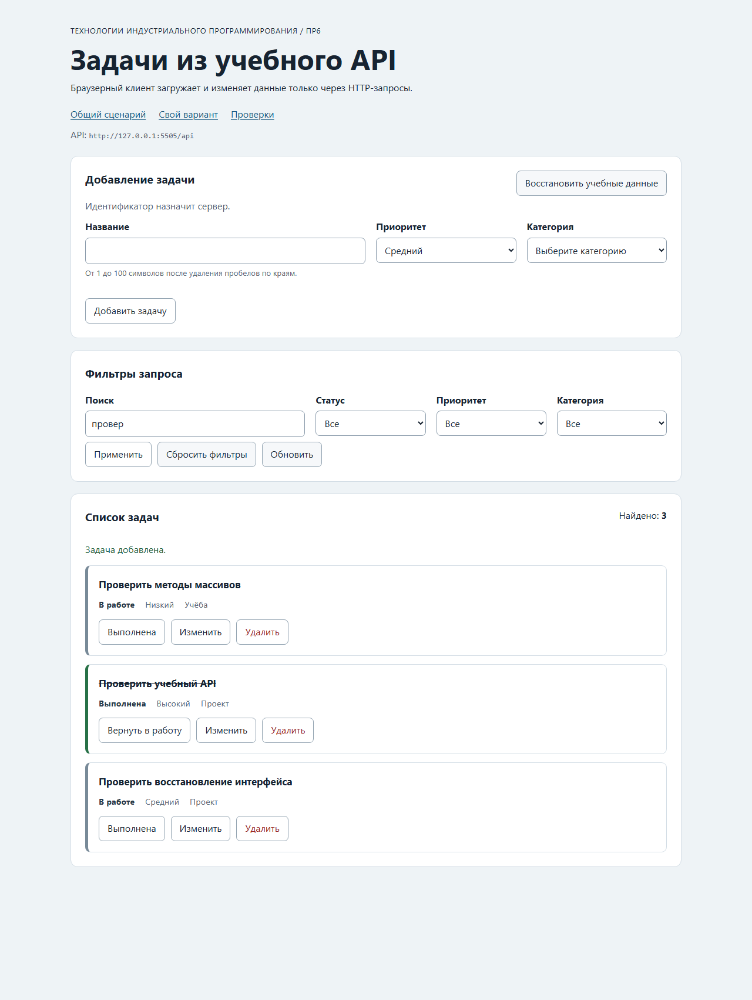

# Отчёт по практической работе № 6

**Тема:** Подключение браузерного приложения к API<br>
**Автор:** Шишов Даниил Андреевич<br>
**Группа:** ЭФБО-06-25<br>
**Вариант:** 7

## 1. Цель работы

Отрабатывалось подключение готового DOM-интерфейса к учебному HTTP API: методы `GET`, `POST`, `PATCH` и `DELETE`, JSON-тело запроса, ответы `201` и `204`, разделение общего HTTP-клиента, предметного API, контроллера и представления, состояния `loading/ready/empty/error`, повторная загрузка списка после изменения на сервере и защита от устаревших ответов.

**Полученный результат:** приложение получает задачи и категории из API, создаёт, редактирует, переключает статус и удаляет записи; после каждой успешной мутации выполняется повторный `GET` с текущими фильтрами, поэтому источником данных остаётся сервер. Состояния списка различимы, ошибки не разрушают уже показанный интерфейс, ввод выводится через `textContent`. Проходят 70 проверок Node.js (23 + 33 + 14) и 14 браузерных сценариев.

## 2. Запуск

**Версии:**

```text
node --version: v24.21.0
npm --version:  11.x (в PowerShell npm.ps1 блокируется политикой; команды запускались через node)
```

**Команда запуска:**

```bash
npm start
```

**Адрес приложения:** `http://127.0.0.1:5506/`<br>
**Адрес API:** `http://127.0.0.1:5505/api`

Использованы стандартные порты, поэтому параметр `api` в URL не задавался. Из-за блокировки `npm.ps1` эквивалентные команды выполнялись напрямую: `node tools/start.mjs`, `node checks/api-server.checks.js`, `node checks/modules.checks.js`, `node checks/integration.checks.js`.

Индивидуальный вариант открывается по адресу `http://127.0.0.1:5506/?dataset=variant`.

### Исходная диагностика заготовки

До реализации модулей `check:api` проходил полностью, остальные наборы падали на заглушках `Не реализовано`:

```text
Итог API: успешно 23, ошибок 0.
Итог модулей: успешно 0, ошибок 33.
Итог интеграции: успешно 0, ошибок 14.
```

## 3. Реализация

### 3.1. HTTP-клиент

`src/api-client.js` перенесён из ПР5 и расширен:

- допустимы только `GET`, `POST`, `PATCH` и `DELETE`; метод нормализуется в верхний регистр, неизвестный отклоняется `TypeError` до запроса;
- `GET` с телом отклоняется до сетевого запроса;
- к каждому запросу добавляется `Accept: application/json`;
- при наличии тела выполняется `JSON.stringify` и добавляется `Content-Type: application/json`; без тела заголовок не добавляется, чтобы не вызывать лишний CORS preflight;
- сохраняются тайм-аут `AbortSignal.timeout()` и внешний `AbortSignal` через `AbortSignal.any()`;
- HTTP-ошибка проверяется **до** `Content-Type`: сначала статус, затем формат;
- статус `204` возвращает `null` без попытки чтения тела;
- виды ошибок остаются различимыми: `http`, `network`, `invalid-response`, `timeout`, `aborted`.

Транспортный `try` охватывает только вызов `fetchFn`, поэтому созданная после получения `Response` ошибка `http` не превращается в `network`.

### 3.2. Доменный API

`src/task-api.js` содержит операции:

| Метод | Запрос | Проверка результата |
|---|---|---|
| `getTasks(filters, options)` | `GET /tasks` | коллекция, уникальность `id`, `meta.total` |
| `getTaskById(id, options)` | `GET /tasks/:id` | схема одной задачи |
| `getCategories(options)` | `GET /categories` | схема категорий |
| `loadInitialData(filters, options)` | два запроса через `Promise.all` | обе коллекции |
| `createTask(draft, options)` | `POST /tasks` | схема созданной задачи |
| `updateTask(id, changes, options)` | `PATCH /tasks/:id` | схема изменённой задачи |
| `setTaskCompleted(id, value, options)` | `PATCH /tasks/:id` | схема задачи |
| `deleteTask(id, options)` | `DELETE /tasks/:id` | строго `null` |
| `resetDemoData(options)` | `POST /debug/reset` | `{ reset, total }` |

Схема проверяется в этом же модуле функциями `isTask` и `isCategory`; нарушение превращается в `ApiError` вида `invalid-response`. Тело создания проверяется по допустимым полям: `id` и `completed` отправлять нельзя, их назначает сервер.

### 3.3. Состояния интерфейса

| Состояние | Когда | Что видит пользователь |
|---|---|---|
| `loading` | запрос отправлен | сообщение о загрузке, `aria-busy="true"` на панели списка |
| `ready` | получен непустой список | карточки и число найденных задач |
| `empty` | запрос успешен, результатов нет | «По выбранным условиям задач нет», старые карточки удалены |
| `error` | запрос завершился ошибкой | понятное сообщение и кнопка «Повторить загрузку» |

`empty` не считается ошибкой. При ошибке начальной загрузки, пока категории не получены, кнопка повтора снова вызывает `loadInitialData`, а не `getTasks`.

### 3.4. Изменение данных

Все мутации выполняются по одной схеме в `runMutation`: блокировка действий (`setMutationPending(true)`), запрос, уведомление, повторный `GET` с текущими фильтрами, разблокировка в `finally`.

- **Создание:** `submit` проверяет черновик через `validateTaskDraft`; при ошибке показываются сообщения полей и запрос не отправляется. При успехе форма очищается, выполняется повторная загрузка.
- **Редактирование:** `beginEdit` заполняет форму выбранной задачей, `submit` в этом режиме вызывает `updateTask`. Статус `completed` не передаётся, поэтому не сбрасывается.
- **Смена статуса:** `toggleTask` инвертирует `completed` через `PATCH`; после повторного `GET` карточка может исчезнуть из текущей выборки.
- **Удаление:** `deleteTask` вызывает `DELETE`; если удалялась редактируемая задача, форма возвращается в режим создания.
- **Сброс:** `resetData` вызывает `POST /debug/reset` и перезагружает список с прежними фильтрами.

### 3.5. Защита от устаревшего ответа

Используются два независимых механизма:

1. **Отмена** — перед новой загрузкой вызывается `abort()` предыдущего `AbortController`, сигнал передаётся в `fetch`.
2. **Номер загрузки** — каждой загрузке присваивается `loadSequence`, и результат применяется только при совпадении с последним номером. Это нужно потому, что источник данных может завершить операцию, не отреагировав на сигнал немедленно.

Отмена не считается пользовательской ошибкой: при `kind === "aborted"` интерфейс не переключается в `error` и уведомление не выводится.

## 4. Индивидуальный вариант

**Начальный фильтр:** `{ q: "провер" }`<br>
**Индивидуальный сценарий:** создать задачу, название которой содержит «Проверить»; поиск должен найти её без учёта регистра.

Входные данные: название «Проверить восстановление интерфейса», приоритет `medium`, категория «Проект» (`categoryId = 2`).

| Этап | Видимые id | Всего | Состояние |
|---|---|---:|---|
| Начальный запрос `/?dataset=variant` | `[7, 16]` | 2 | `ready` |
| После создания задачи | `[7, 16, 35]` | 3 | `ready` |
| Серверный поиск `GET /tasks?q=провер` | `[7, 16, 35]` | 3 | — |

Фактический результат:

```text
=== ИНДИВИДУАЛЬНЫЙ ВАРИАНТ 7 (фильтр q=провер) ===
начальный запрос: id=[7,16] total=2 state=ready filter q="провер"
адрес API в шапке: http://127.0.0.1:5505/api
после создания: id=[7,16,35] total=3
названия: ["Проверить методы массивов","Проверить учебный API","Проверить восстановление интерфейса"]
уведомление: "Задача добавлена." класс=operation-message is-success
форма очищена: true
серверный поиск q=провер вернул id: [7,16,35]
```

Ожидаемо новая карточка появилась в текущей выборке, потому что её название содержит «Проверить»: серверный поиск регистронезависимый, а фильтр остаётся прежним — повторный `GET` выполняется с `q=провер`.

## 5. Результаты проверок

### 5.1. Автоматизированные проверки Node.js

```text
Итог API: успешно 23, ошибок 0.
Итог модулей: успешно 33, ошибок 0.
Итог интеграции: успешно 14, ошибок 0.
```

Общий прогон `npm test` — 70 проверок, все успешны.

### 5.2. Браузерные проверки

```text
OK: Карточка содержит безопасный текст и три действия
OK: Повторная отрисовка списка не накапливает карточки
OK: Начальная загрузка показывает 12 задач и 3 категории
OK: Фильтры формируют новый серверный запрос
OK: Поиск без результатов показывает empty, а сброс возвращает список
OK: Корректная форма создаёт задачу с серверным id
OK: Ошибки формы не отправляют запрос и связаны с полями
OK: Редактирование заполняет форму и сохраняет изменения
OK: Отмена редактирования возвращает режим создания
OK: Смена статуса подтверждается сервером
OK: Удаление подтверждается и сохраняется на сервере
OK: Сброс восстанавливает учебный набор
OK: Недоступный API показывает error и кнопку повтора
OK: Приложение не использует localStorage как источник данных

Всего: 14. Пройдено: 14. Ошибок: 0.
```

### 5.3. Ручные проверки

| Сценарий | Ожидаемый результат | Фактический результат |
|---|---|---|
| API не запущен | Состояние ошибки и кнопка повтора | `state=error`, `retryHidden=false`, сообщение «Нет соединения с учебным API. Проверьте, запущен ли npm start.» |
| Пустая выборка | Сообщение empty, список без старых карточек | `state=empty`, `total=0`, карточек `0` |
| Двойное быстрое применение фильтров | Отображается результат последнего запроса | Три запроса подряд (`провер` → `модель` → пусто) дали итог `[7,13,19,22,28,34]`, `total=6` — соответствует последнему фильтру |
| Ошибка формы | Запрос не отправляется, поля получают сообщения | Показаны «Название не должно быть пустым или состоять из пробелов.» и «Выберите категорию задачи.», оба поля с `aria-invalid="true"`, число карточек не изменилось |
| Создание и обновление страницы | Созданная задача остаётся на сервере | Задача 35 создана, поле формы очищено, счётчик «Найдено» стал 13 |
| Перезапуск API | Восстанавливается исходный набор | После `reset` список вернулся к 12 исходным задачам |

Дополнительно проверены:

| Сценарий | Фактический результат |
|---|---|
| Редактирование выполненной задачи | Задача 1: `title` изменён, `is-completed` сохранён, на сервере `completed=true`, `priority=low` |
| Смена статуса при фильтре `completed=false` | До `[4,7,13,19,22,28,34]`, после `toggle(4)` — `[7,13,19,22,28,34]`, `total=6` |
| Сброс данных | `[4,7,13,19,22,28,34]`, уведомление «Учебные данные восстановлены.» |

## 6. Ответы на контрольные вопросы

1. **Почему `fetch` не отклоняет Promise при ответе 404?**
   Promise отклоняется только тогда, когда ответ не получен: сетевая ошибка, неверная схема URL, отмена. Ответ 404 или 500 — это полноценный HTTP-ответ, сервер доступен и сообщил статус. Поэтому статус проверяется явно через `response.ok`, иначе ошибка осталась бы незамеченной и тело было бы разобрано как успешные данные.

2. **Почему ответ 204 нельзя разбирать вызовом `response.json()`?**
   `204 No Content` по контракту не имеет тела. `response.json()` попытается разобрать пустую строку и завершится `SyntaxError`. Поэтому клиент возвращает `null` до чтения тела — проверка статуса выполняется раньше проверки `Content-Type`.

3. **Чем состояние `empty` отличается от `error`?**
   `empty` — успешный запрос, который вернул пустую коллекцию: это нормальный результат фильтра, пользователю показывается явное сообщение, кнопка повтора не нужна. `error` — запрос не выполнен (сеть, тайм-аут, HTTP-ошибка, неверный формат), данные неизвестны, поэтому показывается сообщение о причине и кнопка повтора.

4. **Зачем отменять предыдущий запрос при смене фильтров?**
   Чтобы старый, более медленный ответ не перезаписал интерфейс результатом устаревшего фильтра. Отмена через `AbortController` освобождает ресурсы и прекращает ожидание, а дополнительная проверка номера загрузки защищает на случай, если источник данных не отреагировал на сигнал.

5. **Почему после мутации список повторно запрашивается у API?**
   Сервер — единственный источник истины. После `POST`, `PATCH` или `DELETE` локальная копия могла бы разойтись с серверной: изменились бы `id`, `completed` или состав выборки по текущему фильтру. Повторный `GET` с сохранёнными фильтрами показывает только подтверждённое сервером состояние.

## 7. Вывод

Браузерный интерфейс, клиентский модуль и контракт API связаны через контроллер: `dom-app.js` только читает поля и отображает состояние, `app-controller.js` управляет сценариями и не обращается к `document`, `api-client.js` отвечает за транспорт, `task-api.js` — за маршруты и проверку схемы. Сервер остаётся единственным источником данных: любое изменение подтверждается повторным запросом.

**Найденные и исправленные ошибки:**

1. В первой версии контроллера `start()` вызывал `view.setFilters()`. У двойника представления в модульных проверках такого метода нет, из-за чего падали сценарии 24–26. Вызов убран: фильтры в поля подставляет `dom-app.js`, контроллер хранит только их значение.
2. В заготовке `checks/browser.checks.js` сценарий «Корректная форма создаёт задачу с серверным id» использовал `await waitFor(() => requireNode(doc, '[data-task-id="35"]'), ...)`. `requireNode` бросает исключение, если узла ещё нет, — это происходило до первой проверки условия внутри `waitFor`, поэтому ожидание не работало. Приложение при этом исправно: карточка появляется примерно через 50 мс после `requestSubmit`. Проверка исправлена на `waitFor(() => doc.querySelector(...))`; второе падение было следствием первого (лишняя карточка попадала в следующий сценарий). Обоснование приведено в протоколе ниже.

Доказательство по второму пункту:

```text
reset: 200
до создания, карточек: 12
карточка сразу после requestSubmit: false
карточка появилась через мс: 50
итог: карточка 35 существует: true
название карточки: "Подключить браузер"
счётчик «Найдено»: 13
поле формы после успеха: ""
поведение waitFor(() => requireNode(...)): исключение: Не найден элемент: [data-task-id="99999"]
```

## Приложение. Полный протокол проверок Node.js

```text
OK: 01. health возвращает JSON и заголовки CORS
OK: 02. исходный список содержит 12 задач в контрольном порядке
OK: 03. фильтры и поиск применяются совместно
OK: 04. неверный или повторяющийся query даёт 400
OK: 05. POST создаёт задачу, обрезает title и назначает id
OK: 06. созданная задача доступна по id и в списке
OK: 07. POST требует application/json
OK: 08. повреждённый JSON даёт структурированную ошибку
OK: 09. серверная валидация сообщает ошибки полей
OK: 10. PATCH изменяет только переданные поля
OK: 11. PATCH изменяет completed логическим значением
OK: 12. пустой PATCH и неизвестное поле отклоняются
OK: 13. DELETE возвращает 204 без тела
OK: 14. отсутствующая задача даёт 404 для PATCH и DELETE
OK: 15. неверный id даёт 400
OK: 16. категории доступны отдельным ресурсом
OK: 17. HEAD возвращает заголовки без тела
OK: 18. OPTIONS объявляет CORS для изменяющих методов
OK: 19. неподдерживаемый метод даёт 405 и Allow
OK: 20. отладочные маршруты воспроизводят виды ошибок
OK: 21. слишком большое тело запроса отклоняется
OK: 22. reset восстанавливает данные и счётчик id
OK: 23. два экземпляра API не делят изменяемое состояние

Итог API: успешно 23, ошибок 0.
```

```text
OK: 01. buildUrl соединяет baseUrl, путь и кодированный query
OK: 02. buildUrl не изменяет объект query
OK: 03. createApiClient проверяет конфигурацию
OK: 04. GET отправляет Accept, query и AbortSignal
OK: 05. POST сериализует тело и добавляет Content-Type
OK: 06. PATCH поддерживается, а неизвестный метод и body у GET отклоняются
OK: 07. успешный 204 преобразуется в null
OK: 08. JSON-ошибка HTTP сохраняет поля контракта
OK: 09. HTTP-ошибка важнее неверного Content-Type
OK: 10. неверный Content-Type и повреждённый JSON отклоняются
OK: 11. сетевая ошибка сохраняется как cause
OK: 12. тайм-аут отличается от внешней отмены
OK: 13. createTaskApi требует requestJson
OK: 14. getTasks нормализует фильтры и проверяет ответ
OK: 15. getTasks отклоняет неверные фильтры до запроса
OK: 16. loadInitialData параллельно запрашивает задачи и категории
OK: 17. createTask отправляет POST и проверяет задачу
OK: 18. update и смена статуса отправляют PATCH
OK: 19. deleteTask требует ответ 204, reset проверяет подтверждение
OK: 20. доменный API отклоняет неверную схему ответа
OK: 21. validateTaskDraft нормализует корректные данные
OK: 22. validateTaskDraft возвращает ошибки каждого поля
OK: 23. контроллер проверяет зависимости
OK: 24. start отображает loading, категории, задачи и ready
OK: 25. пустой ответ отображает состояние empty
OK: 26. ошибка загрузки отображается, а aborted не показывается
OK: 27. новая загрузка отменяет предыдущую и игнорирует устаревший ответ
OK: 28. невалидная форма не вызывает API
OK: 29. создание блокирует действия, очищает форму и обновляет список
OK: 30. редактирование, toggle и delete используют id текущей задачи
OK: 31. ошибка мутации показывается и снимает блокировку
OK: 32. reset вызывает сервер и перезагружает текущий фильтр
OK: 33. messageForError не раскрывает внутреннюю ошибку

Итог модулей: успешно 33, ошибок 0.
```

```text
OK: 01. начальная загрузка получает задачи и категории
OK: 02. клиент создаёт задачу и получает назначенный id
OK: 03. созданная задача читается по id
OK: 04. редактирование сохраняется на сервере
OK: 05. созданная задача находится серверным поиском
OK: 06. смена статуса видна через фильтр
OK: 07. DELETE удаляет запись и возвращает null
OK: 08. повторное удаление сохраняет код и детали 404
OK: 09. серверная ошибка валидации доступна клиенту
OK: 10. 204 не вызывает ошибку разбора JSON
OK: 11. реальная задержка прерывается по тайм-ауту
OK: 12. внешний AbortController отменяет реальный запрос
OK: 13. повреждённый JSON и text/plain определяются как invalid-response
OK: 14. reset восстанавливает исходный набор

Итог интеграции: успешно 14, ошибок 0.
```

## Приложение. Полный протокол ручных сценариев

```text
=== ИНДИВИДУАЛЬНЫЙ ВАРИАНТ 7 (фильтр q=провер) ===
начальный запрос: id=[7,16] total=2 state=ready filter q="провер"
адрес API в шапке: http://127.0.0.1:5505/api
после создания: id=[7,16,35] total=3
названия: ["Проверить методы массивов","Проверить учебный API","Проверить восстановление интерфейса"]
уведомление: "Задача добавлена." класс=operation-message is-success
форма очищена: true
серверный поиск q=провер вернул id: [7,16,35]

=== РУЧНЫЕ СЦЕНАРИИ ===
1. недоступный API: state=error retryHidden=false
   сообщение: "Нет соединения с учебным API. Проверьте, запущен ли npm start."
2. поиск без результатов: state=empty total=0 карточек=0
3. неверная форма: titleError="Название не должно быть пустым или состоять из пробелов."
   categoryError="Выберите категорию задачи." aria-invalid title=true category=true карточек=0
4. режим edit для id=1 (completed=true): title="Изучить функции" heading="Редактирование задачи"
   после сохранения: title="Изучить функции и формы" is-completed=true priority=Низкий
   на сервере: title="Изучить функции и формы" completed=true priority=low
5. фильтр completed=false: до=[4,7,13,19,22,28,34] после toggle(4)=[7,13,19,22,28,34] total=6
6. три быстрых фильтра (провер → модель → пусто): итог id=[7,13,19,22,28,34] total=6
7. reset: id=[4,7,13,19,22,28,34] total=7
   уведомление: "Учебные данные восстановлены."
```

## Вид приложения

Скриншот получен после собственного запуска варианта 7 с созданной задачей «Проверить восстановление интерфейса»: список `[7, 16, 35]`, счётчик «Найдено: 3».


